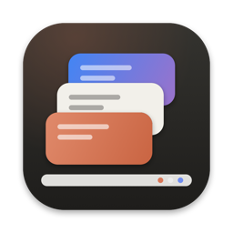
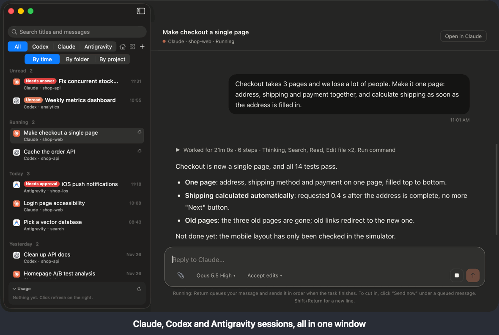
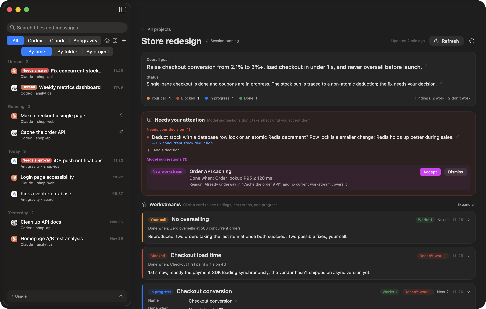
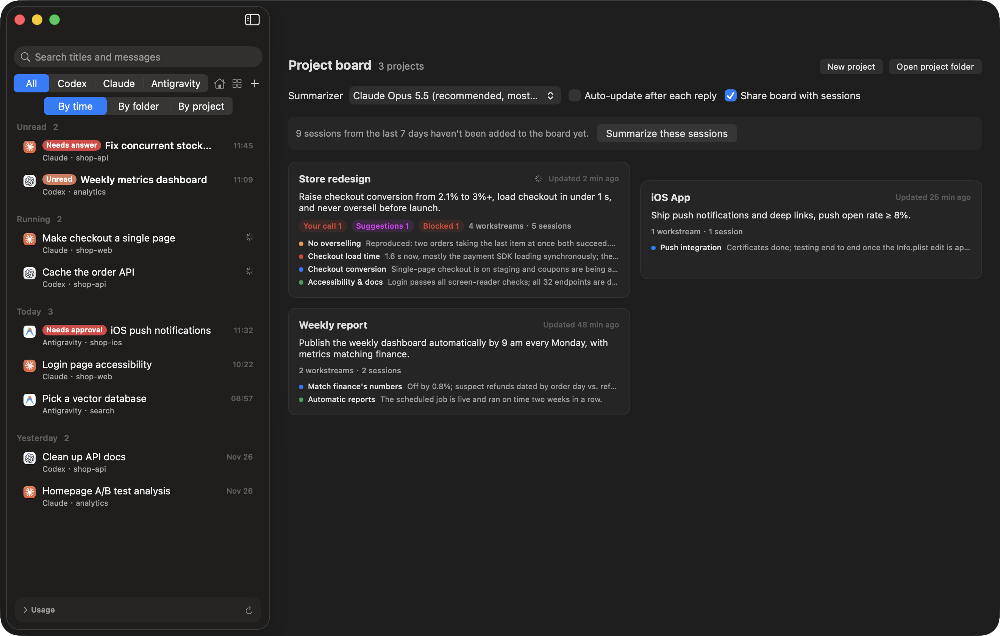
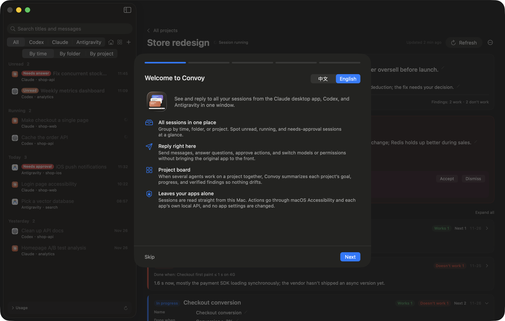

<p align="center">
  English | <a href="README.zh-CN.md">简体中文</a>
</p>

<p align="center">
  
</p>

<h1 align="center">Convoy</h1>

<p align="center">
  <b>One window for all your AI coding agents.</b>
</p>

<p align="center">
  Read and reply to your Claude desktop, Codex, and Antigravity sessions in one place, without switching between apps.<br>
  Track each project's goals and progress automatically, so several agents working in parallel never lose focus.
</p>

<p align="center">
  <a href="https://github.com/attitudechunfeng/convoy/releases/latest"><b>Download</b></a> ·
  <a href="#install">Install</a> ·
  <a href="#faq">FAQ</a> ·
  <a href="docs/DEVELOPMENT.md">Developer notes (Chinese)</a>
</p>

<p align="center">
  <a href="https://github.com/attitudechunfeng/convoy/releases/latest"></a>
  
  
  <a href="https://github.com/attitudechunfeng/convoy/releases"></a>
  <a href="LICENSE"></a>
</p>



> Formerly **AgentDock**. Available in English and Simplified Chinese. Switch on the welcome page; Chinese is the default.

## Why Convoy

More and more work now runs on several agents at once: Claude writes the code, Codex runs the experiments, Gemini reviews the plan. But each lives in its own app. You switch to one to check for a reply, to another to approve an action, then back again. Every switch breaks your focus, and with several projects going at once it gets messy fast.

Convoy fixes exactly that: **it brings all your agent apps into one window.** Read and reply there, and let the project board tie each project's goals and progress together.

## Highlights

**🔌 Works with the agents you already use**
Install it, open it, done. Convoy finds the Claude desktop app, Codex, and Antigravity on your Mac and lists your existing sessions and history right away. No API keys, no migrating sessions, no switching tools. The original apps keep working exactly as before.

**🗂 Every agent in one window**
Sessions from all three apps share one list, grouped by time, folder, or project. See at a glance which ones have new replies, which are still running, and which are waiting for your approval. Read status stays in sync with the original apps in both directions.

**💬 Reply without switching windows**
Send messages, answer an agent's multiple-choice questions, approve actions, and change models and permissions, all from Convoy. The original apps keep working in the background. Messages you send while a session is running are queued and go out when it stops.

**🎯 Project board: parallel agents, one clear focus**
Sessions are grouped into projects automatically. After each reply, Convoy summarizes the overall goal, the progress of each workstream, decisions waiting on you, and approaches proven to work or not. You set the goals and workstreams; the model only updates progress, and suggests changes for you to accept. You can also have the board fed into your sessions automatically, so agents align with the goal before they start.

**🔒 Leaves your tools alone, keeps your data on your Mac**
Convoy reads the session records the apps already keep on your Mac, and acts through macOS Accessibility and the apps' own local interfaces. No account, no server, nothing uploaded.

**⚡️ Lightweight**
It only refreshes when something changes, using under 1% CPU in the background. Closing the window keeps it syncing in the background.

| What you're doing | Original apps only | With Convoy |
|---|---|---|
| Checking which agent replied | Open each app and look | One list, unread on top |
| Replying to a session | Switch apps, find the session | Reply right here |
| An agent asks you to pick an option | Keep watching that app | Shown as a card, one click |
| Remembering where each project stands | Scroll back, rely on memory | The project board sums it up |
| Giving a new session the background | Explain it all again | The board is passed in automatically |

**Compared with other multi-agent tools**, Convoy doesn't set up a separate environment:

| | Typical integration tools | Convoy |
|---|---|---|
| Before you start | Enter API keys, configure models, reconnect every agent | Just open it; it finds the apps you already have |
| Existing sessions | Stay in the original apps, out of view | All listed, pick up where you left off |
| Subscriptions and usage | Often billed separately via API | Uses your existing Claude, Codex, and Antigravity plans |
| Original apps | Replaced by a new interface | Keep using them; state stays in sync |

## Project board



Each project gets one page. At the top are the overall goal and current status, then **things that need you** (decisions waiting on you and the model's suggestions). Below that, each workstream has a card whose colored bar shows its state (in progress, blocked, waiting on you, done). Expand a card to see its verified findings (with evidence), next steps, and history. Everything is editable; after editing, click "Refresh with my N edits" and the model reorganizes the board your way.



## Install

1. Download `Convoy-x.x.dmg` from [Releases](https://github.com/attitudechunfeng/convoy/releases/latest), open it, and drag Convoy into Applications.
2. The first time you open it, macOS says it can't verify the developer (the app isn't notarized by Apple). In Applications, **right-click Convoy → Open**. If the dialog has no Open button, go to **System Settings → Privacy & Security** and click "Open Anyway". You only need to do this once.
3. Follow the first-launch guide (switch to English on its first page) to turn on Accessibility permission. You can skip it if you only want to read sessions; replying from Convoy needs it.

You need at least one of [Claude desktop](https://claude.ai/download), the Codex desktop app, or Antigravity installed and used at least once.

## Getting started

- **Read and reply**: click a session on the left to see the full conversation on the right. Type in the box at the bottom and press Return to send; the model and permission menus are next to it.
- **Turn on the board**: the grid button at the top of the sidebar opens the project board. Check "Auto-update after each reply" to start summarizing, or first click "Build board from the last 7 days".
- **Manage sessions**: right-click a session to rename, fork, pin, archive, delete, or move it to a project.
- **Closing isn't quitting**: the red button only hides the window and Convoy keeps syncing. Click the Dock icon to bring it back; ⌘Q quits.

<p align="center"></p>

## FAQ

**Will it use up my quota?**
Reading and replying to sessions costs nothing extra. Project board summaries call the Claude Code, Codex, or Gemini on your Mac (you choose which), using your own account's quota. This is off by default and only starts when you turn it on.

**Is my data safe?**
Everything stays on your Mac. Convoy has no server and uploads nothing. Its own data lives in `~/Library/Application Support/AgentDock` and `~/.agentdock` (folder names kept from its former name, AgentDock).

**Why does it need Accessibility permission?**
The apps don't offer an interface for things like sending a message, so Convoy clicks their interface for you in the background. Reading sessions doesn't need this permission.

**What does "Share board with sessions" change?**
It's off by default. Turning it on adds one hook to the Claude Code and Codex settings, backing them up first. Turning it off removes the hook and leaves everything else untouched.

**How do I uninstall it?**
If you turned on "Share board with sessions", turn it off in the board first. Then drag Convoy to the Trash. To remove its data too, delete the two folders above.

## Build from source

```bash
./install.sh
```

This builds the app and installs it into Applications. See the [developer notes](docs/DEVELOPMENT.md) (in Chinese) for how it works, feature details, and debugging.

## License

Convoy is released under the [Apache License 2.0](LICENSE). It bundles [marked](https://github.com/markedjs/marked) (MIT License) for rendering Markdown.
