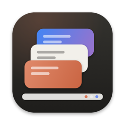
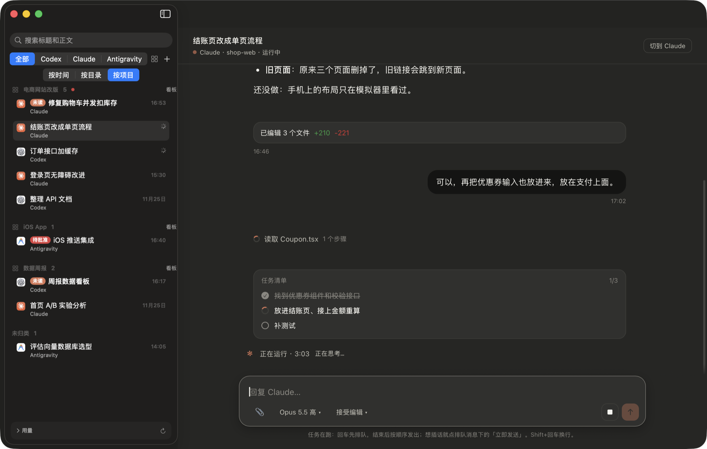
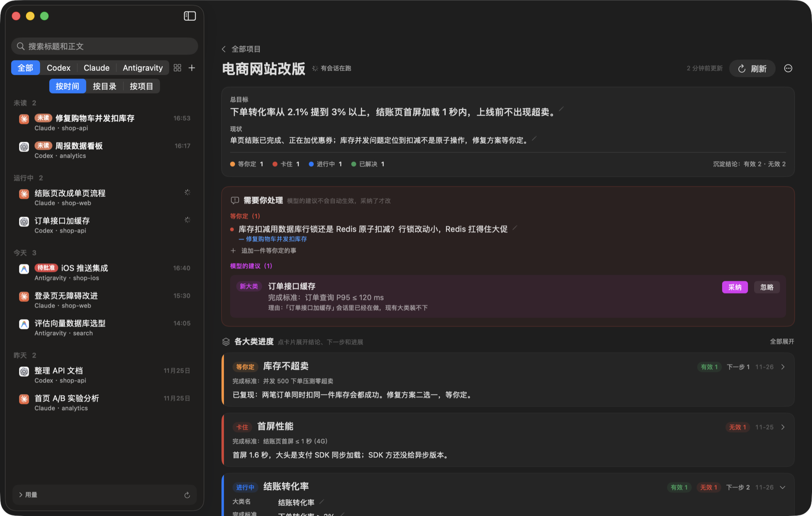
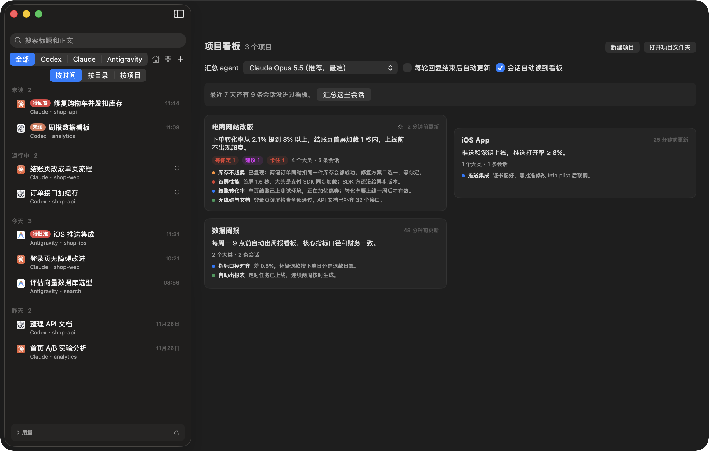
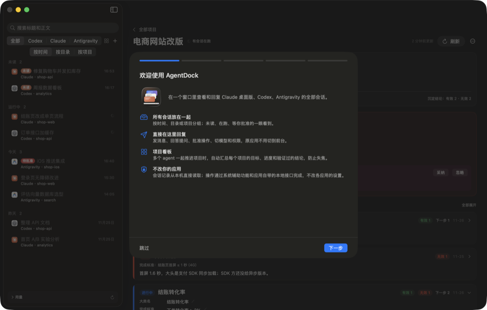

<p align="center">
  <a href="README.md">English</a> | 简体中文
</p>

<p align="center">
  
</p>

<h1 align="center">AgentDock</h1>

<p align="center">
  <b>一个窗口，管好你所有的 AI 编程 agent。</b>
</p>

<p align="center">
  Claude 桌面版、Codex、Antigravity 的会话放在一起看、一起回，不用在几个应用之间来回切。<br>
  还能按项目自动追踪目标和进度，几个 agent 同时干活也不失焦。
</p>

<p align="center">
  <a href="https://github.com/attitudechunfeng/agentdock/releases/latest"><b>下载</b></a> ·
  <a href="#安装">安装</a> ·
  <a href="#常见问题">常见问题</a> ·
  <a href="docs/DEVELOPMENT.md">开发说明</a>
</p>

<p align="center">
  <a href="https://github.com/attitudechunfeng/agentdock/releases/latest"></a>
  
  
  <a href="https://github.com/attitudechunfeng/agentdock/releases"></a>
</p>



## 为什么做它

现在很多工作要几个 agent 并行协作：Claude 写代码，Codex 跑实验，Gemini 帮着评审方案。可它们各在各的应用里，一会儿切到这个看有没有回复，一会儿切到那个批准一个操作，再切回来接着聊。窗口来回切，注意力跟着被打断，几个项目同时推进时更容易乱。

AgentDock 要解决的就是这件事：**把多个 agent 应用收进一个窗口**，在这里看、在这里回，再用项目看板把每个项目的目标和进度串起来。

## 为什么用它

**🔌 无痛接入你已经在用的 agent**
装好打开就能用：自动找到本机装的 Claude 桌面版、Codex、Antigravity，已有的会话和历史记录直接列出来。不用填 API Key，不用迁移会话，也不用换掉手上的工具，原应用怎么用还怎么用。

**🗂 一个窗口管全部 agent**
三个应用的会话放进同一个列表，按时间、目录或项目分组。哪条有新回复、哪条还在跑、哪条在等你批准，一眼就能看到，已读状态和原应用双向同步。

**💬 不切窗口就能回复**
发消息、回答 agent 的选择题、批准操作、切换模型和权限，都在 AgentDock 里完成，原应用在后台照常工作，不用来回切。会话还在跑时发的消息会自动排队，等它停下再发出。

**🎯 项目看板：多个 agent 并行也不失焦**
自动把会话归到项目，每轮回复结束后汇总：总目标、各条工作线的进度、等你拍板的事、实测有效和无效的做法。目标和工作线由你来定，模型只更新进度，想改目标时会先提建议等你采纳。打开后还能把看板自动带进会话，让 agent 每次动手前先对齐目标。

**🔒 不改你的工具，数据不出本机**
直接读取各应用留在本机的会话记录，通过系统的辅助功能和应用自带的本地接口操作。不用注册账号，没有服务器，不上传任何内容。

**⚡️ 轻**
有变化才刷新，后台常驻 CPU 不到 1%。关掉窗口也会在后台继续同步。

| 你在做的事 | 只用原应用 | 用 AgentDock |
|---|---|---|
| 看三个应用里谁回复了 | 挨个打开、挨个翻 | 一个列表，未读置顶 |
| 回复一条会话 | 切到那个应用、找到会话 | 当前窗口直接回 |
| agent 问你选哪个方案 | 得盯着那个应用 | 弹成卡片，点一下 |
| 记住每个项目做到哪了 | 靠翻聊天记录、靠记忆 | 项目看板自动汇总 |
| 新开的会话不了解前情 | 手动把背景再讲一遍 | 看板自动带进会话 |

**和其他多 agent 集成工具比**，AgentDock 不另起一套环境：

| | 常见的集成工具 | AgentDock |
|---|---|---|
| 开始用之前 | 填 API Key、配置模型、重新接入每个 agent | 打开就行，自动找到本机已装的应用 |
| 已有的会话 | 留在原应用里，看不到 | 全部列出来，接着聊 |
| 订阅和额度 | 往往按 API 另外计费 | 用你现有的 Claude、Codex、Antigravity 订阅 |
| 原应用 | 被替代，换一套新界面 | 照常用，两边状态同步 |

## 项目看板



每个项目一页：最上面是总目标和现状，接着是**需要你处理**的事（等你拍板的决定、模型的建议），下面每条工作线一张卡片，左边的颜色条表示状态（进行中、卡住、等你定、已解决）。展开能看到这条线上验证过的结论（附依据）、下一步和进展记录。每一处都能直接改，改完点“按我的修改刷新”让模型照你的意思重新整理。



## 安装

1. 从 [Releases](https://github.com/attitudechunfeng/agentdock/releases/latest) 下载 `AgentDock-x.x.dmg`，打开后把 AgentDock 拖进“应用程序”。
2. 第一次打开时，系统会提示“无法验证开发者”（应用没有经过 Apple 公证）。在“应用程序”里**右键 AgentDock → 打开**；如果弹窗里没有“打开”按钮，去 **系统设置 → 隐私与安全性**，点“仍要打开”。只需要这一次。
3. 跟着首次启动的引导走，打开“辅助功能”权限。只看会话的话不开也行；要在 AgentDock 里回复，就需要它。

需要至少装了一个：[Claude 桌面版](https://claude.ai/download)、Codex 桌面版、Antigravity，并且用它们聊过天。

## 上手

- **看和回**：左栏点一条会话，右边就是完整对话；底部输入框回车发送，旁边可以切模型和权限。
- **开看板**：左栏顶部的方格按钮打开项目看板，勾选“每轮回复结束后自动更新”就开始汇总；也可以先点“从最近 7 天的会话建看板”。
- **管会话**：右键会话可以改名、分叉、置顶、归档、删除，或者归到某个项目。
- **关窗口不退出**：点红点只是收起窗口，后台继续同步；点程序坞图标再打开，⌘Q 才是真退出。

<p align="center"></p>

## 常见问题

**会不会花我的额度？**
看会话、回复会话不额外花。项目看板的汇总会调用你本机的 Claude Code、Codex 或 Gemini（在看板里选），用的是你自己账号的额度，默认关闭，打开才开始。

**我的数据安全吗？**
所有东西都在本机。AgentDock 没有服务器，不联网上传。它自己的数据放在 `~/Library/Application Support/AgentDock` 和 `~/.agentdock`。

**为什么要“辅助功能”权限？**
各应用没有开放“发消息”之类的接口，AgentDock 需要在后台替你点它们的界面。只看会话不需要这个权限。

**“让会话读到看板”会改什么？**
这一项默认关闭。打开时会在 Claude Code 和 Codex 的配置里各加一个钩子，改之前先备份；关掉时会把钩子摘掉，别的设置不动。

**怎么卸载？**
如果开过“让会话读到看板”，先在看板里关掉；然后把 AgentDock 拖进废纸篓。想连数据一起删，再删掉上面那两个文件夹。

## 从源码编译

```bash
./install.sh
```

编译并装到“应用程序”。实现原理、各功能细节和调试方法见 [开发说明](docs/DEVELOPMENT.md)。
